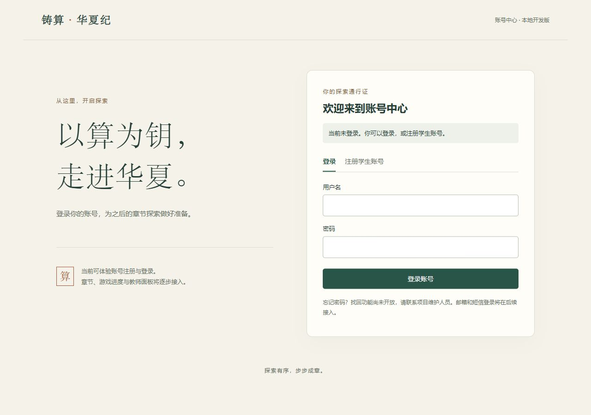

# 铸算·华夏纪 · 账号与基础权限模块

本仓库是《铸算·华夏纪》的账号与基础权限模块，采用 Django、PostgreSQL 和模板页面。本地已完成第1—8组，包含受限维护台、修改密码和人工协助重置；尚未接入完整游戏，也没有共同云端。第7—8组未同步GitHub，已发布版本仍为第1—6组。

## 已实现与未实现

| 已实现 | 尚未实现 |
| --- | --- |
| 注册、登录、退出、修改密码、人工协助重置密码 | 邮箱与短信验证码自动找回 |
| 固定用户ID、角色分离、受限教师/班级维护网页 | 批量导入、完整审计搜索及大规模维护工具 |
| 授权班级列表、当前启用学生名单、名单CSV | 游戏章节、任务、云端游戏存档、成绩和成绩面板 |
| 班级范围检查、维护变更撤销目标账号全部旧会话 | 生产部署、100人负载验收 |
| CSRF、密码强度、数据库共享限流、失败提示 | Chrome/Edge/Firefox/Safari逐项兼容性验收 |

新注册用户只获得学生身份。没有默认管理员或共享教师密码；教师角色和班级授权不会因为下载代码而自动生成。已有教师账号可从账号中心进入“查看授权班级”。维护人员可通过受限网页分配教师身份、班级和授权，首次维护身份须由可信终端初始化。

先自行注册维护专用账号，再由项目负责人在本机运行下列命令，替换实际用户名，之后重新登录：

```powershell
.\.venv\Scripts\python.exe -X utf8 manage.py provision_maintainer your_username
```

此命令不创建账号、不设置密码或staff/superuser。详情见 [维护台使用说明](docs/MAINTENANCE.md)。

希望在自己的本地数据库演示教师入口，可由开发人员按 [本地教师演示准备](docs/LOCAL_DEMO.md) 手动授权，不会创建对外的提权接口。



[教师功能验收预览（临时测试数据）](docs/images/teacher-scope.png)

## 下载后会得到什么

Fork只在GitHub创建代码副本，仍须将代码下载到电脑并完成以下安装。每个人使用自己的数据库、账号和密钥，彼此的数据不会共享；运行网页后才能在浏览器访问。GitHub仓库不是已部署的平台，GitHub Pages不能直接运行本项目的Django后端和PostgreSQL。

仓库不包含 `.env`、`.env.test`、本地数据库、会话、数据库程序、虚拟环境、Node依赖或真实账号。测试代码中出现的样例密码仅用于隔离测试，不是可登录的共享账号。不要上传数据库备份、日志或真实师生信息。

## 已选环境

- Python 3.12（本次实际运行 3.12.14），Django 5.2 LTS（补丁版本见 requirements.txt）。
- PostgreSQL 17，本地独立实例仅监听 127.0.0.1:55432。
- Django 模板页面复用现有 JSON 接口，服务端会话，默认同站访问。
- 本地运行不安装系统服务，不对外网开放。不得把开发服务器直接作为生产服务。

## 首次安装：Windows本地独立方案

需要 Git、稳定版 Python 3.12，以及 PostgreSQL 17 的Windows x64二进制程序。Node.js只在运行页面开发检查时需要，启动网页不需要Node。

### 1. 下载代码并准备Python环境

```powershell
git clone https://github.com/PearCrown/zhusuan.git
cd zhusuan
py -3.12 -m venv .venv
.\.venv\Scripts\python.exe -m pip install -r requirements.txt
```

如果使用自己的Fork，将clone地址替换为你的仓库地址。也可以下载ZIP并解压，在项目目录打开PowerShell，再执行创建环境和安装依赖两条命令。后续命令不需要手动激活虚拟环境。

### 2. 准备独立数据库

从 [EDB官方Windows二进制下载页](https://www.enterprisedb.com/download-postgresql-binaries) 获取PostgreSQL 17。解压到项目 `.local/postgres/`，确保以下路径存在；不要把二进制文件提交Git：

```text
zhusuan/
  manage.py
  .local/
    postgres/
      pgsql/
        bin/
          pg_ctl.exe
          initdb.exe
```

然后执行：

```powershell
.\.venv\Scripts\python.exe -X utf8 scripts\local_db.py start
```

首次启动会自动生成仅本地保存的随机密钥、数据库密码和 `.env`，创建项目专用数据库及普通应用账号，不安装Windows服务。默认只监听 `127.0.0.1:55432`，**不是**PostgreSQL常见的5432端口。此方案不要提前复制一个秘密为空的 `.env`；若文件已存在，脚本不会覆盖它。已有数据库也不会被重置。

### 3. 建表、初始化角色并启动网页

```powershell
.\.venv\Scripts\python.exe -X utf8 manage.py migrate --noinput
.\.venv\Scripts\python.exe -X utf8 manage.py init_roles
.\scripts\start.ps1
```

打开 [http://127.0.0.1:8000/](http://127.0.0.1:8000/)，自行注册学生账号、登录并退出。窗口内按Ctrl+C停止网页服务。没有游戏章节或成绩属于当前功能边界，不是安装失败。

`init_roles`可重复执行，不创建用户、不改变组成员或班级关系；它会把student、teacher、maintainer三个保留组的权限恢复为代码定义。不要给这些保留组随意增加权限。

## 以后再次启动

在项目目录打开PowerShell：

```powershell
.\.venv\Scripts\python.exe -X utf8 scripts\local_db.py start
.\scripts\start.ps1
```

打开 [http://127.0.0.1:8000/](http://127.0.0.1:8000/)。使用 `--noreload` 运行，修改Python代码或模板后需要停止并重新启动网页服务。

```powershell
# 单独检查配置和数据库，均不建表
.\.venv\Scripts\python.exe -X utf8 manage.py check
.\.venv\Scripts\python.exe -X utf8 manage.py check_db
# 停止本地数据库
.\.venv\Scripts\python.exe -X utf8 scripts\local_db.py stop
```

`start.ps1` 如被系统执行策略阻止，可直接运行：

```powershell
.\.venv\Scripts\python.exe -X utf8 manage.py runserver 127.0.0.1:8000 --noreload
```

## 使用已有PostgreSQL / macOS或Linux

Windows独立数据库脚本不适用于其他系统。已有数据库或其他系统应自行准备PostgreSQL 17、专用普通登录角色及其拥有的空数据库；应用角色不要使用数据库超级用户。复制 `.env.example` 为 `.env`，填写DB_*及至少50字符的随机DJANGO_SECRET_KEY。数据库密码也必须自行生成；DB_PORT应改成实际监听端口。

macOS/Linux命令参考（这些系统尚未逐项实机验收）：

```powershell
python3.12 -m venv .venv
.venv/bin/python -m pip install -r requirements.txt
cp .env.example .env
# 在本地编辑.env，配置已准备好的数据库和随机密钥，再继续：
.venv/bin/python manage.py migrate --noinput
.venv/bin/python manage.py init_roles
.venv/bin/python manage.py check
.venv/bin/python manage.py check_db
.venv/bin/python manage.py runserver 127.0.0.1:8000 --noreload
```

Windows使用已有数据库时，使用 `.venv\Scripts\python.exe` 执行上述manage.py命令，不要运行独立数据库控制脚本。可在自己的终端用以下命令生成新密钥，复制到自己的.env中，切勿粘贴到公共仓库或聊天：

```powershell
.\.venv\Scripts\python.exe -c "import secrets; print(secrets.token_urlsafe(64))"
```

`.env`、`.local`、`.venv` 均不提交。其中 `.local` 包含数据库数据和仅本机使用的初始化凭据，不可公开分享。若 `.env` 已存在，启动脚本不会覆盖；若修改了数据库密码，必须在数据库中同步修改，不能指望脚本自动重置。

## 常见启动问题

| 现象 | 处理 |
| --- | --- |
| 找不到Python 3.12 | 先安装稳定版3.12；不要依赖Windows应用商店的python占位命令 |
| 提示缺少pg_ctl.exe | 核对解压层级，必须符合上面的.local/postgres/pgsql/bin路径 |
| 提示缺少密钥/数据库密码 | 独立方案确认没有提前创建空.env；已有数据库方案补齐自己的配置，不要删库重建 |
| 数据库无法连接 | 确认数据库已启动、端口正确且未被占用，执行manage.py check_db；检查本地.local日志，勿公开包含敏感信息的日志 |
| 首次注册提示暂不可用 | 确认已经执行migrate和init_roles，并查看本地错误信息 |
| PowerShell阻止运行.ps1 | 使用上面列出的python manage.py启动/测试命令，不必更改全局执行策略 |
| 修改后页面还是旧版本 | 停止并重新启动网页服务，再刷新浏览器 |

## 当前边界

- 已建立自定义用户与班级数据，并完成首次迁移。数据库中没有默认的 auth_user 表；已经解除第1组迁移保护。
- `/health/live/` 仅表示网页进程存活，**不代表数据库可用**。数据库单独使用 `check_db` 检查。
- `.env.example` 中秘密为空，缺少必要配置会明确报错；不允许自动回退 SQLite。
- 当前提供账号操作页面及 `/auth/csrf`、`/auth/register`、`/auth/login`、`/auth/me`、`/auth/logout`。继承的 email 字段未验证，不能用于登录或密码找回。
- 页面可注册学生账号，登录后可修改密码；遗忘时由维护人员核实后发放一次性凭据，本人设置新密码。没有共享密码，教师身份不能自选。短信/邮箱登录及自动找回仍未开放，见 [密码使用说明](docs/PASSWORDS.md)。
- `/teacher/` 已提供授权班级列表、学生名单和名单CSV导出，服务器检查角色、操作权限和班级范围；无成绩数据或授权修改入口。
- 内置浏览器的账号流程及教师授权/撤权流程已验收。尚未验证其他浏览器、生产部署、游戏成绩接入和100人并发。
- PostgreSQL 开发、测试角色均无建库权限；两个角色不能连接对方数据库。测试库仅可存放可丢弃的测试数据。

## 隔离测试

本机数据库运行后，首次准备专用测试库，再执行测试：

```powershell
.\.venv\Scripts\python.exe -X utf8 scripts\setup_test_db.py
.\scripts\test.ps1
```

脚本只用于本项目自有本机实例。它会创建 `.env.test` 及专用低权限测试角色/数据库，并取消开发库与测试库的 PUBLIC 连接权限，确保相互隔离。不会给开发或测试角色授予建库权限，不删除数据库。其他部署环境须由数据库维护人员单独准备测试角色和数据库。

测试脚本使用 `config.test_settings`、`--keepdb`，保留专用测试库结构，每轮开始前核对目标库并清理残留数据，防止手动实测或中断留下的记录影响测试。不要在测试库放真实数据；不要指定其他数据库运行测试。直接运行 `manage.py test` 会被拒绝。

## 页面状态检查（开发时可选）

运行网页本身只需要 Python 和 PostgreSQL。另有33项页面状态检查，使用 Node.js 22或24的稳定版本和开发依赖，不连接数据库、不代替真实浏览器验收：

```powershell
npm ci
npm run test:ui
```

依赖已用 package-lock.json 锁定，node_modules 不提交。后端测试使用上面的 scripts/test.ps1，完整回归及后续密码/维护定向检查通过，具体证据见PROGRESS.md。开发与测试数据库隔离；不要同时对同一个测试库执行手动服务验收和后端测试，因为测试开始时会清空专用数据。

## 更新与后续计划

更新代码前备份自己的数据库并保存本地改动；取得更新后重新安装requirements.txt中的依赖，执行migrate与init_roles，再重启服务。Fork不会自动与原仓库保持同步。升级不能通过删除数据库或迁移文件来解决冲突。

第7—8组已提供维护、审计和密码恢复。下一组是游戏接入样例，尚未实现；后续成绩与进度入口还须接入相同权限检查，名单页面不代表完整教学成绩面板。

开发服务器只供本地使用；上线还需要HTTPS、生产进程管理、代理配置、备份恢复、依赖安全检查及容量验收。目前不代表生产就绪。

## 项目文档

- [阶段进度与验收记录](PROGRESS.md)
- [账号API](docs/API.md)
- [用户、角色与班级数据](docs/DATA_MODEL.md)
- [教师接口与班级范围](docs/TEACHER_ACCESS.md)
- [受限维护台与首次初始化](docs/MAINTENANCE.md)
- [修改密码与人工协助重置](docs/PASSWORDS.md)
- [可选的本地教师演示准备](docs/LOCAL_DEMO.md)
- [自主复查与已知边界](docs/REVIEW.md)
- [首次GitHub交付审查](docs/RELEASE_REVIEW.md)

## 版本依据

- Django支持周期：https://www.djangoproject.com/download/
- Python兼容范围：https://docs.djangoproject.com/en/5.2/faq/install/
- PostgreSQL二进制来源：https://www.enterprisedb.com/download-postgresql-binaries
