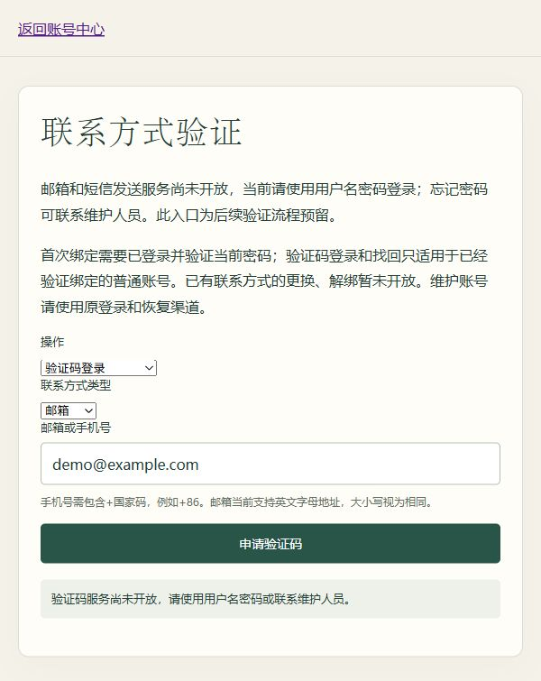

# 第11组：验证码本地流程

入口GET `/verification/`，可选择首次绑定、验证码登录或找回密码。本组在开发内存发送器下完成本地逻辑，不表示已开通邮件/短信。默认disabled，所有验证码操作统一503 code_unavailable，不建挑战、不发送消息。生产无可用发送适配器，不能把memory用于上线。

## 接口

全部同站Cookie、POST JSON、有效CSRF，路径无末尾斜线，无查询参数；错误复用统一JSON/no-store。不能通过前端提交userId、role、verified_at或目标账号。三个purpose为bind/login/reset，stage为request/verify，路径 `/auth/code/{purpose}/{stage}`。

- request：严格kind（email/phone）、destination。bind另需currentPassword以及已登录普通账号。kind与地址复用CONTACTS.md规范。返回202及challengeId、expiresIn=300、通用message，不返回验证码或是否存在账号。
- verify：严格challengeId、code（六位ASCII数字）；reset另需newPassword（原密码强度/长度规则）。bind成功返回bound/loginRequired；reset返回passwordChanged/loginRequired；login返回原账号user及csrfToken。没有自动注册或合并。
- 只允许首次绑定。已有同类联系方式拒绝更换；地址被其他账号占用时数据库约束拒绝，不改归属。绑定须当前密码与新地址验证码同时通过，成功增加会话版本、审计并退出所有旧设备。
- 登录与找回仅查VerifiedContact，不使用User.email。普通教师也可使用；停用、maintainer、staff、superuser均不支持此验证码入口，未知/受限身份返回相同申请响应。公开错误结构相同不等于经过计时侧信道审计。

## 时效、并发和失败

ContactChallenge只存带密钥HMAC验证码摘要、浏览器随机标识摘要、账号认证状态、用途、目标、过期时间、失败次数和消费时间。目标地址是数据库敏感资料，原始验证码只短暂存在开发发送器内存。不给前端提供读取验证码的接口，不进URL/日志/审计。

申请时浏览器会话创建随机标识；验证码绑定该浏览器会话、用途、目标和固定用户，换浏览器/退出后不能继续使用。有效期5分钟，连续输错5次锁定；错误次数在事务退出后返回错误，避免回滚丢失计数。账号密码或会话版本变化、停用、权限升级或联系方式移除后拒绝。

共享数据库限流：申请IP每600秒30次、地址每3600秒10次、地址每60秒1次，绑定当前密码核验每账号600秒10次；验证IP每600秒60次。均固定时间窗口（边界附近可能短时间连发两次），不是严格间隔60秒冷却；429不自动重试。限流主题经HMAC后落库，不存裸地址。

同一浏览器同一地址用途重新申请使旧挑战失效；各请求锁User再锁挑战，绑定/密码/会话版本/审计/消费同事务。并发重置仅一次成功；归属冲突或审计失败整体回滚。验证码登录刷新Django会话并设绝对有效期，复用原Cookie认证机制。

发送失败回滚挑战，计数仍保留；外部供应商将来可能已经发送但响应丢失，收到验证码也不保证挑战有效。事务已提交后的退出/会话持久化/网络失败可能使结果不确定，前端引导先查身份或尝试新密码，不自动重放。前端隐藏/离开清空秘密及挑战，修改地址或类型也清空挑战，确认密码不发往后端。

## 运行与尚未完成

显式DEBUG=True及CONTACT_MESSAGE_BACKEND=memory时才能开发测试。验证码只能由同一进程受信任测试读取get_sender().drain()，不是普通终端跨进程收件箱；不应创建公开调试接口。默认本地网页仍disabled，用户不能收取真实验证码。

未做真实供应商、短信/邮件实发、更换/解绑、旧地址通知、挑战定期清理与保留期任务、维护账号自动找回。过期挑战不会通过验证，但仍占数据库空间；真实开放前须制定隐私保留期与清理任务，并做容量、跨浏览器和部署验收。不能仅配置memory后对外发布。

## 本轮证据

完整后端209项通过，随后追加归属冲突/审计回滚和并发一次性消费，验证码17项定向通过；页面44项通过。浏览器仅核对新增页面和默认关闭发送时的真实提示，未在浏览器修改密码或宣称短信收取成功。增量迁移accounts.0007应用开发/测试库，未删除真实数据或授予权限。第9组浏览器CSV下载补验仍未完成。

第12组已提供挑战记录保留/分批清理命令，默认只预览，详见 [CLOUD_DEPLOYMENT.md](CLOUD_DEPLOYMENT.md)。上文清理未做为第11组历史边界；真实发送、更换/解绑和通知仍未实现。
