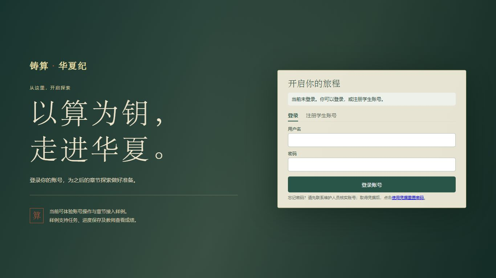
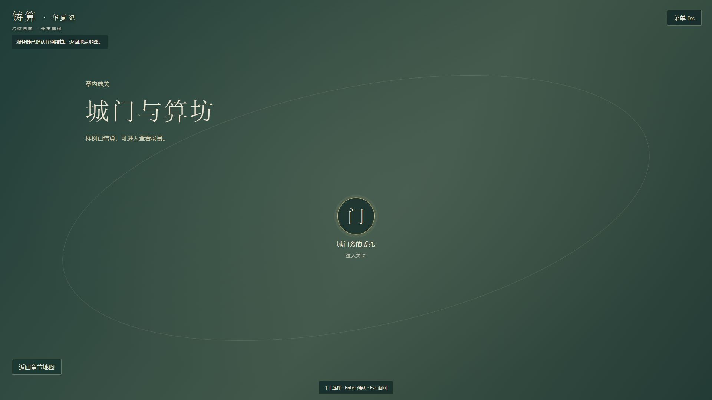
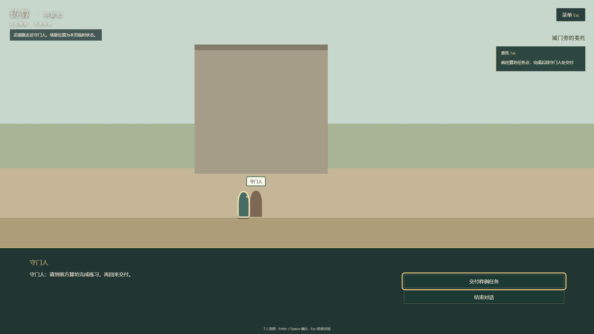
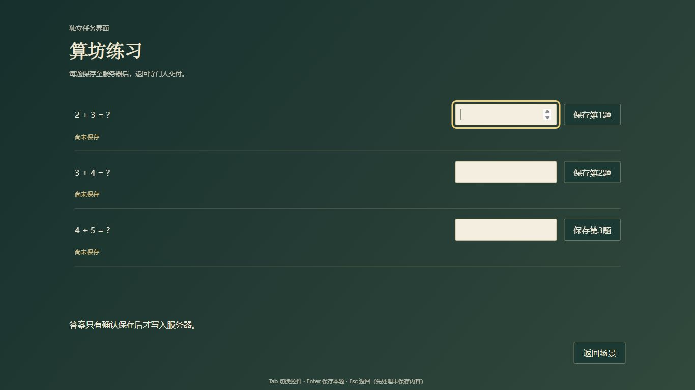

# 全屏游戏与输入纠偏：差异、实现和验证

日期：2026-11-07（Asia/Shanghai）。任务[A-005](tasks/A-005.md)。用户要求暂停新增功能并优先纠正界面与操作；本轮不推送GitHub、不部署、不发布。A-004进行中的代码被保留并在此范围内修正，未重建项目。

## 差异与处理

| 要求 | 原实现差异 | 本次修改 |
|---|---|---|
| 登录/地图/场景/任务铺满视口 | 首页网站页头、双列普通页面；游戏有居中卡片和纵向文档流 | 登录独立全视口皮肤；/game/直接使用全屏选关和横版主画面；对话HUD/整屏任务覆盖层；无Fullscreen API依赖 |
| 背景可替换 | 无集中背景配置 | game-assets.js集中loginBackground资源引用、裁切位置与已有渐变占位；表单/认证逻辑分离 |
| 键盘移动、范围鼠标交互 | 屏幕方向按钮，目标不能直接点 | 移除虚拟方向键；A/D和左右键按住移动；E和目标点击共用距离守卫；范围内pointer和悬停高亮，范围外不触发 |
| 全键盘目标选择 | 缺目标切换 | 默认距离优先，同距按稳定ID；Q显式切换仍在范围内的目标，HUD显示当前目标 |
| 当前界面解释输入 | 未提供完整菜单/对话/任务按键体系 | 场景、对话、地图、任务、暂停、未保存选择分配输入；上下键选项，Enter/Space确认，Esc关闭/暂停；场景Tab切任务栏，表单与菜单保留Tab导航 |
| 隔离角色输入 | 面板焦点丢失或点击目标后移动失效；底层控件还能被聚焦 | 输入锁、按键清空、重复键防穿透、失焦清空；覆盖层底层控件inert，模态焦点循环；保存后恢复原输入框焦点 |
| 不绕过权威进度 | 现有样例本就只有一次结算，非正式关卡模型 | 不改账号/CSRF/HTTP/数据库/旧档。只有服务端响应更新展示；退出只检查旧样例已结算，不写客户端通关标记 |

键位与现有A/D、方向键、E无冲突；新增映射以本次用户指令为准。Q用于重叠目标切换。移动不绑定鼠标点击坐标；仅角色到达范围后可点实体。

## 文件和资源入口

- templates/home.html保留既有表单ID及accounts.js；新增game-login.css为本页专用皮肤，不影响教师后台。
- static/js/game-assets.js是登录背景唯一配置入口：修改loginBackground.src为项目静态资源地址、position为安全裁切位置即可；src为空时复用现有绿色综合渐变占位。没有生成最终美术或新增背景图。
- templates/game.html是游戏页面唯一结构来源；static/scene-demo.html仅跳转/game/，避免维护两份UI。
- scene-demo-data.js保存稳定ID、归一化交互位置和可替换外观参数；scene-model.js不读取图像像素；scene-view.js与scene-demo.css负责外观。
- 原scene-host.js、chapter-sdk.js、服务端状态转换、题库版本和数据库迁移保持不变。原game.js不再装配到/game/；其SDK/安全边界测试已随新页面适配，不以旧页面测试冒充新页面验收。

## 实际验证

执行环境：Windows，Node v24.21.0，npm 11.19.0；本仓库已有npm run test:ui入口。此前已完成npm ci，本轮未新增依赖/锁文件。

- npm run test:ui：最终80项通过，0失败。包括原账号/教师/维护/密码/验证码/SDK测试、17项SceneHost及18项新页面/输入/资源检查。
- node --check：scene-demo.js、scene-model.js、scene-view.js、game-assets.js等新增JS语法检查通过。
- 源码复查：检查实际场景装配、模型、DOM目标回调、SDK、原服务端transition/apply_action与输入生命周期；没有UI自报成绩或完成写入。
- 浏览器：内置浏览器使用仅监听loopback的临时虚构接口。没有真实账号、数据库、会话凭据、发消息或外部服务；临时服务验收后停止。以下只证明前端适配和操作，不是Django/PostgreSQL或云端验收。

| 浏览器检查 | 1366×768 | 1920×1080 |
|---|---|---|
| 登录/注册 | 页面滚动尺寸1366×768；注册面板scrollHeight=clientHeight=609 | 页面滚动尺寸1920×1080；注册面板scrollHeight=clientHeight=655 |
| 选关/横版 | 页面滚动尺寸等于视口；对话与选项在可见范围内 | 页面滚动尺寸等于视口；HUD和对话在可见范围内 |
| 独立任务（三题） | 页面768高；任务内容scrollHeight=clientHeight=428 | 页面1080高；任务内容scrollHeight=clientHeight=724 |

实际键盘演练：虚构登录→Tab/Enter进入→Enter两级地图→D按住移动→E对话→Enter接取→Tab收起HUD→D到任务点→E进入→Tab切输入、Enter保存→Esc显示保存/放弃/继续→Enter保存返回→A回NPC→E/Space交付→D到出口→E返回选关。没有用鼠标移动角色。任务返回的style位置61.2138%、camera translateX(-32.2138%)与进入前完全一致；NPC在结算后显示“委托已交付，感谢相助”。

鼠标补验：范围外点击守门人未打开对话；范围内点击和E进入同一处理；点击目标后仍能用D移动。输入释放、blur、面板锁、重叠目标顺序、重复挂载、未保存保存/丢弃/继续、背景引用替换由自动检查覆盖。Enter/Space、上下键、Esc及表单Tab有浏览器操作证据。

后台/PostgreSQL测试、真实服务端完整流程、100人负载和跨浏览器矩阵：未执行。本克隆无虚拟环境/数据库配置，未读取或操作其他开发数据；本轮没有Python业务或迁移变更。不会沿用历史228项通过冒充本次后端验证。

## 自主复查修正

1. 对话/保存时控件暂时disabled导致焦点丢失：在请求结束、重新启用后恢复到当前选项或原答案框。
2. 场景目标是button，范围外点击后的焦点会被通用按钮输入过滤：将场景实体明确保留在场景上下文，补回归。
3. 返回选关时目标按钮可能仍处于inert/disabled：先刷新上下文，网络结束后恢复选关焦点。
4. 不把暂停/任务/对话背景控件留在Tab路径；重复确认键不会关闭覆盖层后再触发一次交互。
5. 单视口截图捕获曾发生裁切，与DOM尺寸不符；已换用fullPage截图并打开本地截图复核，不把裁切图当布局结果。

## 尚未实现的要求与边界

- **逻辑门Demo尚不存在**：当前是原算术样例的可键盘操作适配，不声明电路连线或逻辑门的键盘替代已完成。
- **独立挑战流程未实现**：未为了本次修UI添加NPC或移动到挑战模式，也未新增一个假的挑战入口。
- **正式任务提交、通关、奖励模型仍缺**：现有算术样例为逐题保存→返回NPC交付/服务端结算；不是完整的独立任务提交/核验→剧情更新→clearLevel协议。新关卡实例、服务端出口核验、奖励及多次尝试要另行接轨；本轮只保留旧样例条件，不伪造正式通关。
- 美术仍为占位；登录未有正式可用图片，以原有渐变呈现。超小窗口或200%等高缩放可能启用表单/长题目容器内滚动作为保底，不承诺所有尺寸都无内部滚动。
- 场景位置只保留当前页面运行时；刷新和隐藏后重新验证身份回地图，不是云检查点恢复。隐藏页面仍会清空未保存输入，这是现有生命周期限制，本轮没有把它说成草稿恢复通过。

## 实际截图（虚构接口，占位美术）

以上为本地截图，不是线上部署。交付只保存本地检查点，未推送或创建新的PR。
