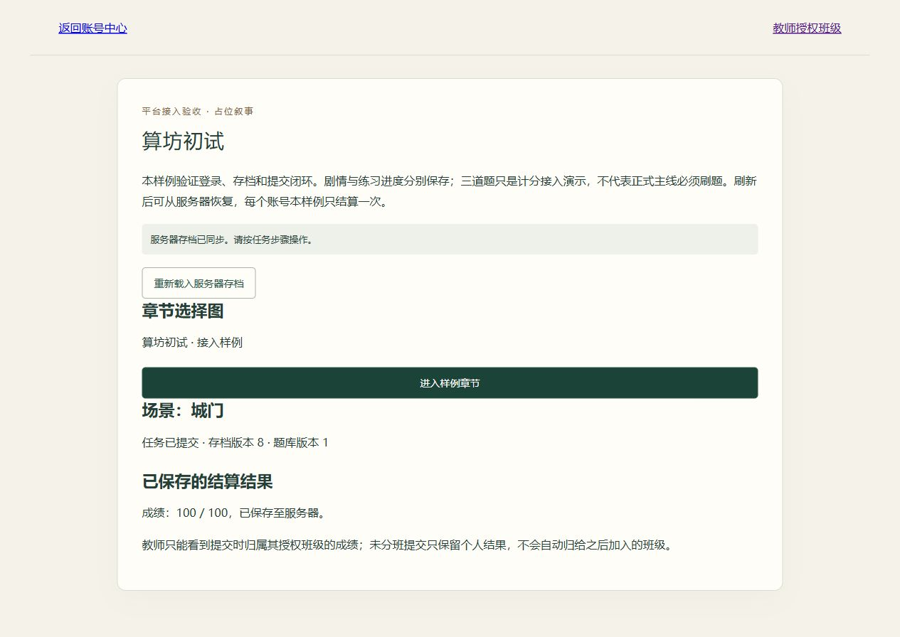
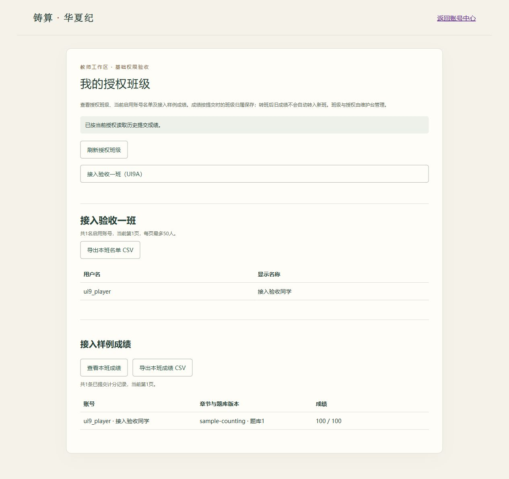

# 第9组：可玩接入样例

这是技术组共同试玩法的最小接入样例，未确定正式剧情。打开 `/` 注册/登录，从“进入接入样例”前往 `/game/`；选择章节，与NPC对话、接任务、前往算坊、每题保存答案、回城门提交。刷新后重新进入章节可恢复服务器状态。教师登录后选择授权班级，点击“查看本班成绩”；名单和成绩分别导出。

当前章节选择是单卡片占位，场景切换是文字/界面状态切换，没有正式地图、美术或游戏引擎。样例每人只结算一次，不能清档重刷；正式练习多次作答、最好成绩/最新成绩策略需另行设计，不应覆盖已提交记录。

## 扩展边界

- 主线剧情任务与计分练习可以分别注册为并行章节。样例 `story` 与 `practice` 为不同状态分支；三题任务不代表正式主线必须刷题。
- 服务端章节注册、状态迁移和题库发布由受信任代码维护；不是上传任意脚本的插件市场。不执行用户上传代码。
- 存档已写入当前服务器的PostgreSQL，不在浏览器本地保存。部署到共同服务器后才是多人共同云端；现在仍是本机服务。
- 没有完整题库后台、批量导入、真实短信/邮件、正式剧情或100人容量验收。公开仓库中的示例题目及答案不能承担保密考试用途。

## 服务端章节接口

在 `gameplay/chapters.py` 注册 `Chapter`，固定 `id`（最多64字符）、title、schema_version、kind、initial_state、transition、grade、actions；可选 question_bank_id/version。重复章节ID启动时报错，不能静默替换。

- `initial_state(bank_id, version)` 返回可JSON序列化的初始状态；无题库章节可忽略两个空参数。
- `actions` 是动作名到额外允许字段集合的映射。所有修改仅接受动作，服务器验证后产生新状态，不能信任客户端上传的完整存档、成绩、用户ID或班级。
- `transition(state, action, payload)` 返回新状态；验证动作顺序及每个字段的类型、范围。样例对状态先复制，拒绝未接任务作答、未完成答案提交等情况。
- 完成动作统一命名 `submit`；`grade(state)` 返回0—100整数，不能由客户端提供。纯剧情章节传 `grade=None`，仍能提交完成，结果score/maxScore为null，不进入计分报表。已通过独立纯剧情插件测试。
- schema_version改变后旧存档返回409 `save_version_unsupported`，维护人员须先做显式数据迁移；绝不自动重置玩家进度。版本号与存档revision用途不同。
- 新增章节需配套自己的前端场景渲染，使用下述SDK。当前 `/game/` 的渲染器仅实现sample-counting；注册服务端章节不会自动生成其游戏界面。

## HTTP与统一存档

接口路径不加末尾斜线，默认同站Cookie。读取支持GET/HEAD；修改仅POST JSON，必须有效登录与CSRF。统一 `{ok,data}` / `{ok:false,error}` 及no-store，参见API.md。

| 路径 | 用途 |
| --- | --- |
| `/game/api/chapters` | 章节id、标题、结构版本与kind，无查询参数 |
| `/game/api/chapters/{id}/progress` | 当前账号的存档、saveContext及公开题目，无查询参数 |
| `/game/api/chapters/{id}/action` | 操作并保存，每账号每分钟120次限流 |
| `/game/api/teacher/classes/{classId}/scores?page=1` | 授权班级已提交计分记录，每页50条 |
| `/game/api/teacher/classes/{classId}/scores.csv` | 独立成绩导出权限，无查询参数，最多2000条，超限拒绝而非截断 |

存档 `progress`：chapterId、schemaVersion、revision、state、questionBank:{bankId,version}、result。未提交result为null；提交后包含score、maxScore、submittedAt。读取未开始章节时revision=0，不创建数据库行。读接口另返回saveContext和questions（仅questionId/prompt，不含答案）。

动作请求必须且仅含 `{action, revision, saveContext}` 及该动作额外字段。样例额外字段：move传scene（gate/workshop），answer传questionIndex与answer；talk/accept/submit无额外字段。答案是0—10000整数，不接受布尔值。

revision是客户端最后读取的版本，每次成功操作加1。版本过时409 `save_conflict`，重新读取后由玩家操作，不自动重放。saveContext绑定当前会话、账号、章节结构和题库版本，是旧页面保护值，不能代替登录或CSRF。

服务器事务锁定账号，串行化同账号修改，避免并发首次保存产生两份记录；成绩与完成状态同事务写入。提交已完成章节再次submit返回原结果，不重复计分；其他修改409。网络中断可能发生在提交已成功后，界面不能宣称失败后自动重试，应重新读取确认。

## 浏览器SDK

载入 `static/js/chapter-sdk.js` 后创建 `new window.HuaxiaChapterClient(chapterId, {onProgress, onScore})`。

- `await client.load()` 读取状态，返回含progress、saveContext、questions的数据。
- `await client.dispatch(action, fields)` 自动携带当前revision/saveContext并刷新CSRF，成功才更新本地展示并调用回调。
- `onProgress(progress)` 收到服务器存档；已提交状态另调用 `onScore(result)`。回调用于展示，可在读取既有结果时重复发生，不能据此另行记账或重复奖励。
- `client.invalidate()` 清空引用并拒绝旧请求迟到回填；宿主页面在隐藏、离开或切换身份时应清空DOM，返回后重新load。SDK不单独管理页面生命周期。
- 同时只允许一次操作，12秒超时；无自动重试，无localStorage身份/存档。宿主处理异常并引导重新读取；不要在回调中发起递归保存。

## 题库更新接口与版本

`gameplay/question_bank.py` 是当前提供器：`register_release(bank_id, version, questions)`、`get_release`、`public_questions`、`grade`。Question包含固定id、prompt、answer、points；示例发布总分100。发布内容为不可变数据，同一bank/version重复注册拒绝。未来数据库适配器保持此契约；当前没有通过公网修改题库的API。

更新流程：新增题库版本，例如同一bank的"2"，保留"1"及其题目；再把章节默认question_bank_version切换为"2"，随代码重启服务。新玩家首个成功保存时固定新版本；已有保存继续使用记录的旧版题目/答案位置/评分。尚未首次保存的旧页面提交会409，必须重新载入，避免新题配旧答案。改变题量的版本已覆盖测试。

不要修改已有版本题目顺序、答案或分值，不要删除仍被存档引用的旧版。旧版缺失返回409 `question_version_unavailable`，不能改用最新版偷偷评分。若状态结构本身改变，还需提高schema_version并显式迁移。未来后台必须补录入校验、草稿发布、引用检查及维护审计；这些并未由当前注册函数代办。

## 教师数据归属

每次成绩读取/导出复用现有教师身份、操作权限、启用班级及显式班级授权检查。查看需view_class_progress；导出另需export_class_scores。维护人员或superuser不会自动绕过业务授权。

提交时记录submission_class快照。之后学生转班或停用，原班授权教师仍能看到其已提交历史成绩；当前名单则只列当前本班启用账号，两者可能不同。未分班提交只保留个人结果，不自动关联后来加入的班级。没有完整转班历史或跨班成绩搬迁工具。

成绩只返回必要身份、章节、分数、提交时间及题库版本，不返回学生答案。CSV有UTF-8 BOM与公式前缀保护；数据库错误返回JSON，不产生半截文件。已下载文件无法通过撤权收回。

## 验收证据（2026-10-28）

186项完整后端测试通过，41项DOM状态检查通过。覆盖权限/CSRF、坏字段、状态顺序、刷新恢复、伪造成绩、并发初存、重复提交、事务回滚、版本切换、纯剧情章节、历史班级归属及CSV限制/公式保护。随后仅修正文案，补充成绩撤权及迟到响应检查后，41项DOM检查通过。

内置浏览器在专用测试库使用临时账号完成登录→接任务→切场景→保存答案→刷新恢复→提交100分→刷新保留结果→教师查看本班100分。CSV后端验证通过；本轮浏览器下载事件未取得可靠完成证据，不将它记录为真实下载通过。仅验收内置浏览器，未证明Chrome/Edge/Firefox/Safari完整兼容或100人并发。

后续用户网页人工验收已实际确认名单及成绩CSV下载、中文和100分内容，补齐本组当时未确认的浏览器下载项。具体来源与范围见 [人工验收记录](MANUAL_ACCEPTANCE_2026-10-28.md)；上文为开发阶段历史证据，非跨浏览器结论。
