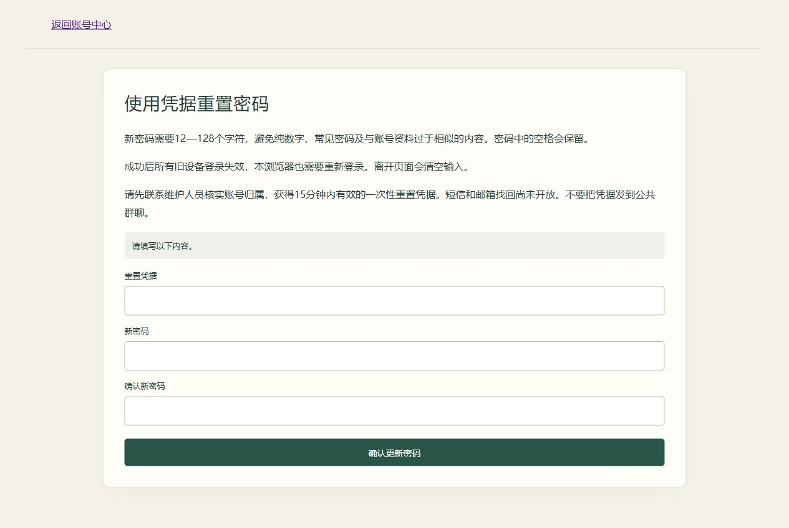

# 重置密码入口与导航整理（2026-10-28）

本轮是网页体验优化，未改动身份、密码、凭据有效期或权限规则，未改变数据库结构。

## 网页完整操作路径

维护账号登录→进入维护台→在目标账号行点击“协助重置密码”→核对目标、版本、本人归属并输入维护员当前密码→生成成功→先复制凭据→点击“打开重置密码页面”→账号本人粘贴凭据并填写新密码。

不再要求退出维护账号后寻找登录表单入口，也无需手输网址。链接仅为/password/reset/，不含凭据、用户ID或其他敏感参数，不预填凭据、不写浏览器存储。离开维护页面仍按原规则清除原文，凭据仍为15分钟一次性使用。维护员只交付凭据，不能看到本人设置的新密码。

## 链接出现的环节

| 页面状态 | 导航行为 |
| --- | --- |
| 维护首页 | 显示操作菜单、账号/班级及审计，不显示返回自己的链接 |
| 具体维护表单 | 只保留当前表单与返回入口，不重复展示全部菜单、账号列表和审计 |
| 凭据生成成功 | 突出下一步重置链接及复制提醒，隐藏生成表单与无关操作，避免误点重发 |
| 登录表单 | 保留“使用凭据重置密码”；移除需先登录的游戏快捷链接 |
| 验证码关闭 | 首页不显示验证码链接，原接口/直接页面仍保留关闭说明 |
| 验证码开发可用 | 登录区与已登录区分别显示对应入口，不在页头重复显示 |
| 教师页面 | 品牌改为文本，只保留一个返回账号中心的链接 |
| 游戏页面 | 移除始终展示的教师链接，教师从账号中心按身份进入工作区 |
| 密码操作完成或需返回登录 | 显示就近的返回登录链接，隐藏重复的页头返回链接 |

## 验证

密码/维护/导航共43项定向后端通过，全部45项DOM检查通过；没有因低风险界面改动重复跑未涉及的业务测试。配置、迁移一致性通过，无新迁移。

真实浏览器使用隔离数据库的临时维护员和普通账号，从登录、维护首页、账号行进入生成表单，实际生成一次测试凭据。成功页检查：重置链接可见、href无凭据、无其他菜单或生成表单；点击后抵达三个输入框的重置页。没有在浏览器输入新密码，没有修改真实评测账号密码，测试凭据未截入预览。临时测试账号、凭据、审计和会话已定向清理，隔离服务停止；开发服务同步最终代码。

本轮仅本地提交，未自动推送GitHub。隐藏链接只整理界面，不替代服务器鉴权；生产部署、跨浏览器矩阵与容量验收不在本轮范围内。
