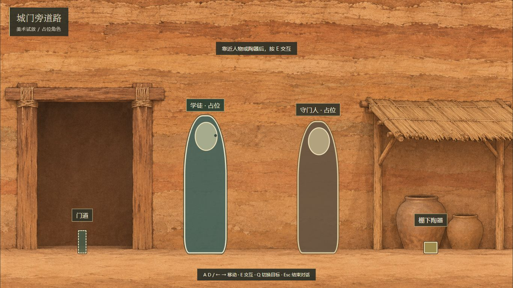
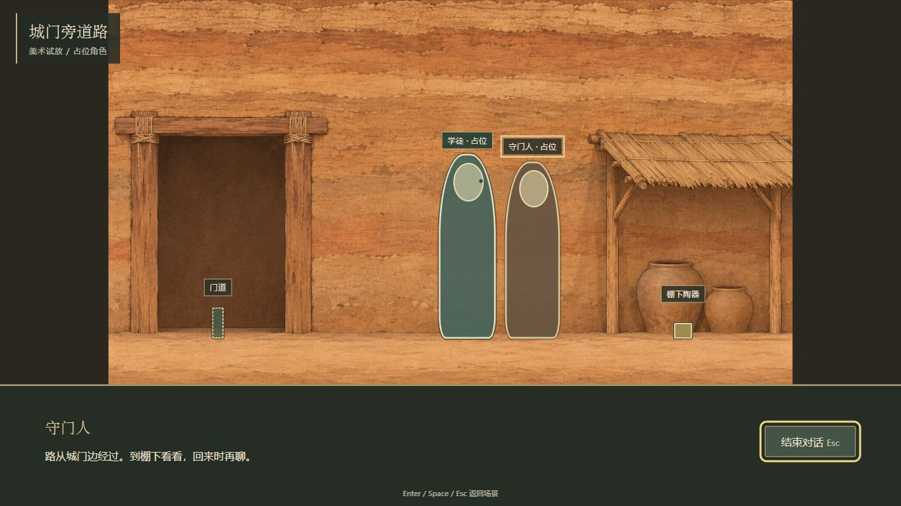
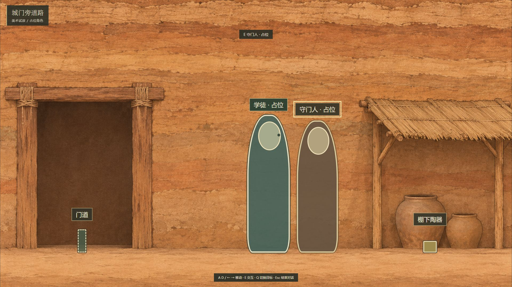

# 城门单场景美术试放

日期：2026-11-07；任务C-002-A；基线b3d76e0；本地分支codex/c002-scene-art-preview-20261107。只作概念构图与操作试放，待统筹验收、视觉只读复核。无发布或部署。

## 入口与运行

当前预览：[http://127.0.0.1:8767/scene-art-preview.html](http://127.0.0.1:8767/scene-art-preview.html)。本地loopback静态服务保留运行供复核，浏览器标签也保留为交付。它不是Django应用或云端，也不需要登录。

在本工程根目录用已安装的Node启动（本轮实际执行的PowerShell命令）：

```powershell
node -e 'const http=require("node:http"),fs=require("node:fs"),path=require("node:path"),root=path.resolve("static");http.createServer((q,s)=>{try{const route=decodeURIComponent(new URL(q.url,"http://localhost").pathname),f=path.resolve(root,"."+(route==="/"?"/scene-art-preview.html":route));if(!["GET","HEAD"].includes(q.method)||!f.startsWith(root+path.sep)){s.writeHead(404);s.end();return;}const bytes=fs.readFileSync(f);s.setHeader("Content-Type",f.endsWith(".js")?"text/javascript":f.endsWith(".css")?"text/css":f.endsWith(".png")?"image/png":"text/html; charset=utf-8");s.setHeader("Cache-Control","no-store");s.end(q.method==="HEAD"?undefined:bytes);}catch{s.writeHead(404);s.end();}}).listen(8767,"127.0.0.1",()=>console.log("static preview 127.0.0.1:8767"));'
```

若8767已运行本预览，不要再启动第二份；关闭该Node进程/终端或按Ctrl+C可停止。命令只读static，不列出目录，不执行POST，不读取环境或数据库。没有创建系统服务或安装新依赖。

本机`py -3.12 --version`返回没有合适运行时，因此没有使用Python服务器，也没有安装Python；改用现有Node v24.21.0的标准库。

操作：A/D或左右键按住移动，松开即停；E与范围内目标交互；Q切换重叠目标；范围内可点目标；Enter/Space/Esc结束对话。窗口失焦、隐藏或对话打开都会清空移动输入。原生Edge的URL识别保护保持有效，本轮仅使用可用内置浏览器，不声称真实Edge切页验收通过。

## 文件范围与复用

新增：

- static/scene-art-preview.html
- static/js/scene-art-preview.js
- static/css/scene-art-preview.css
- static/assets/preview/gate-road-concept-v01.png
- 本文及docs/images/scene-art-preview-*四张截图

复用HuaxiaSceneModel、HuaxiaSceneView、HuaxiaInputLocks；没有修改scene-view.js或其他共用代码，也没有修改正式scene-demo.js、数据、模板、依赖、登录、教师端、API或数据库。预览自己的数据采用viewportSpan=1，不注册章节、不保存、不写正式通过/成绩/奖励。简短试放对白不是正式剧情定稿。

## 素材出处和统一画布

纯背景原件：资料根目录下`视觉探索/规范V1.1/CH01_S02_城门旁道路_concept_v01.png`。副本尺寸1672×941，复制前后SHA-256均为：

`28DBA87615ADEB30A9D427FE429793A402404B9C0DD3A8FA0F3B604FCDB6201F`

原图待考据/评审，原卡记为生成式概念图；本次仅本地试放，不新增考据或使用权结论。没有读取合成图裁人物，没有生成美术、扩图、重采样或改写原图。

设计画布固定为1672×941。stage中的图片、世界、占位角色和交互点共用同一容器，统一使用：

`scale = min(可用宽 / 1672, 可用高 / 941)`

图片按完整画布contain显示，允许留边；不cover、不拉伸到正式Demo的1.724屏。采用浮点getBoundingClientRect测量可用区，避免clientHeight取整造成亚像素越界。对话出现时在画面下方预留独立区域，再整体等比缩小场景；不是把脚线单独挪上去。

主角可见轮廓高度为0.48×941=451.68设计像素，NPC为0.46×941=432.86；脚底统一落在0.88×941=828.08。这里40%—55%的分母是**被等比显示的场景画布高**，不是含对话框的整页高。对话缩小时同一角色占场景画高仍为48%，其占整个浏览器的比例会降低；此设计供统筹/视觉复核，不借此宣布最终人物比例定稿。

预览站位：主角出生x=0.40，NPC x=0.62、交互半径0.11，陶器调查x=0.84、半径0.07，门道x=0.16、半径0.085。交互距离仍由原SceneModel判定；大轮廓的宽高、透明边/绘制形状不改变交互范围。主角与NPC在首次进入范围的位置留有间隔；目标标签在轮廓上层，提示移到上方以免挡脚。

## 实际验证

- `node --check static/js/scene-art-preview.js`通过。
- `npm run test:ui`最终89项通过、0失败；此入口仍为原有前端回归，本轮没有改package.json或堆叠静态样式测试。
- 另外通过Node stdin临时执行8项JSDOM行为检查：单屏/设计画布、范围外点击/E拒绝、按住/松开移动、对话锁、Esc不穿透、范围内点击复用守卫、blur与resize、无API写入/浏览器存储。检查脚本未写入工程，不冒充真实后端。
- 内置浏览器实际加载纯静态页面，验证范围外点击未打开对话、键盘接近后E打开、对话中D按住不移动、Esc关闭、缩放后角色归一化位置保持不变及可见焦点。
- 实测进入对话前后style.left保持52.4475%（首轮）；对话中D按住后数值不变。后续截图捕获的站位约52.5%，截图间不要求键盘计时完全相同。
- 正式文件与b3d76e0做只读diff，scene-demo.js、scene-demo-data.js、scene-view/model/host、game/home模板和package.json均无变化。

| 视口/状态 | 图片显示宽×高（约px） | 主角/图片高 | 脚线/图片高 | 脚到对话框的间距 |
|---|---|---|---|---|
| 1366×768 普通 | 1364.61×768 | 48% | 88% | 不适用 |
| 1366×768 对话 | 1037.12×583.69 | 48% | 88% | 70.04px |
| 1920×1080 普通 | 1918.98×1080 | 48% | 88% | 不适用 |
| 1920×1080 对话 | 1492.54×840 | 48% | 88% | 100.80px |

四状态页面scrollWidth/Height等于目标视口。NPC在1920普通状态实测约46%画高。四张截图均保存为工具原始JPEG后，用本地图片查看工具打开复核；没有后期合成或裁切来掩盖问题。

## 复查与限制

首轮发现目标提示位于脚线附近，已移至上方；对话缩小时角色标签字号已提高，保持可读。对话锁只释放自己的token，关闭后重置按键和帧时差；窗口缩放只改统一画布scale，不改模型坐标。

仍为静态占位轮廓，没有透明人物、角色动画、碰撞避让或自然步态；两个轮廓若被玩家故意移动到相同x可重叠，正常首次交互站位保持分离。没有正式NPC/剧情、任务运行器、通关、后台或数据联调。背景的材质密度、最终色彩、目标位置及角色比例仍待视觉/统筹复核，不以本次参数替代美术定稿。

## 新截图





